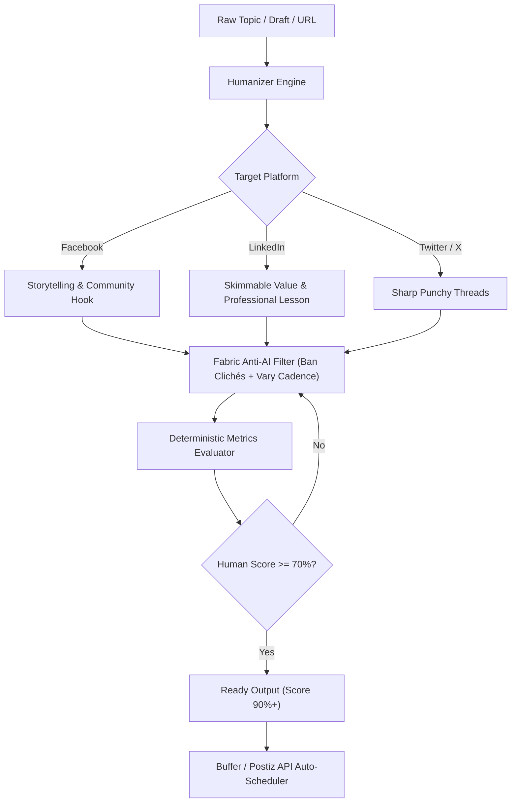

# Social-Humanizer 🧠✍️

[](https://opensource.org/licenses/MIT)
[](https://python.org)
[](http://makeapullrequest.com)
[](https://github.com/psf/black)

> **Stop sounding like an AI bot.**  
> `social-humanizer` is an open-source Python engine and CLI that strips robotic clichés, enforces natural sentence burstiness, and writes authentic, high-engagement posts for **Facebook**, **LinkedIn**, and **Twitter/X**.

---

## 🌪️ The Problem

Most AI-generated social media posts suffer from obvious "AI-isms":
- ❌ **Emoji bullet spam** at the start of every line (`🚀`, `🔥`, `💡`, `🎯`).
- ❌ **Robotic clichés**: *"In today's fast-paced digital landscape...", "Let's delve in...", "সাফল্যের মূল চাবিকাঠি"*.
- ❌ **Monotonous rhythm**: Every sentence is exactly 14–18 words long with zero human cadence.
- ❌ **Platform mismatch**: Using LinkedIn "broetry" (double-spaced single sentences) on Facebook where it looks like spam.

## 💡 The Solution

`social-humanizer` combines:
1. **Fabric's de-AI Philosophy**: Banning AI clichés, de-jargoning, and enforcing sentence length variety (Burstiness).
2. **Platform-Specific Copywriting Structures**:
   - **Facebook**: Conversational storytelling, 2–3 sentence natural paragraphs, friendly community vibe, genuine discussion starters.
   - **LinkedIn**: High-CTR attention hooks, skimmable insights, professional takeaways, modest first-person voice.
   - **Twitter/X**: Punchy, high-impact phrasing under character limits.
3. **Deterministic Quality Scoring**: A math-based evaluator that checks Burstiness ($CV = \sigma / \mu$), Reading Ease, and flags AI terms.
4. **Bilingual Engine**: Fully supports both **English** and **Bengali (বাংলা)** natively.

---

## 🏗️ Architecture



---

## ⚡ Quickstart

### 1. Installation

Clone the repository and install dependencies:

```bash
git clone https://github.com/your-username/social-humanizer.git
cd social-humanizer
pip install -e .
```

*(Note: The core evaluator runs in pure Python with zero mandatory dependencies!)*

---

### 2. CLI Usage

#### Evaluate any text for robotic AI patterns:
```bash
python -m social_humanizer.cli score "In today's fast-paced digital world, it is crucial to delve into AI."
```

**Output:**
```text
============================================================
Overall Status: ⚠️ Robotic / AI-Like (Score: 55.0/100)
Total Words: 12 | Sentences: 1
Burstiness (Cadence Variance): 0.00 (Higher is better)
Reading Level: Standard Social (Grade 7-8) (Ease: 67.8)
Flagged AI Clichés: delve
Recommendations:
 - Remove robotic AI terms: delve
============================================================
```

#### Evaluate Bengali posts:
```bash
python -m social_humanizer.cli score "আজকের ডিজিটাল বিশ্বে প্রোগ্রামিং শেখার গুরুত্ব অপরিসীম। আসুন জেনে নিই এই বিষয়ে।"
```

#### View the system prompt for Facebook or LinkedIn:
```bash
python -m social_humanizer.cli prompt --platform facebook
python -m social_humanizer.cli prompt --platform linkedin
```

---

### 3. Python SDK Usage

```python
from social_humanizer import evaluate_text, HumanizerEngine, Platform

# 1. Deterministic Text Evaluation
report = evaluate_text("Computers are basically dumb. If you miss a semicolon, it gives up.")
print(f"Human Score: {report.human_score}/100")
print(f"Burstiness: {report.burstiness_score}")

# 2. Build Humanizer Prompt Payload for any LLM
engine = HumanizerEngine()
payload = engine.build_prompt_payload(
    draft="Why moving from Windows to Linux WSL was surprisingly easy.",
    platform=Platform.FACEBOOK
)
```

---

## 📊 Before vs. After Showcase

### ❌ Typical AI Output (Robotic & Cringe):
> 🚀 **Unleash Your Coding Potential Today!** 🔥  
> In today's fast-paced digital landscape, programming has emerged as a game-changer. 💡  
> Here are 3 vital takeaways:  
> 🎯 Foster critical thinking  
> 🎯 Elevate your career trajectory  
> 🎯 Revolutionize your problem-solving  
> What are your thoughts? Comment below! 👇  
> `#Coding #Innovation #Growth #Success`

### ✅ Humanized Output (Social-Humanizer):
> Coding taught me one humbling lesson: computers are surprisingly dumb.  
> 
> They do exactly what you write, not what you intended. Miss one tiny semicolon? The compiler panics like the sky is falling.  
> 
> Who else has lost half their night's sleep just to find a single typo? 😅

---

## 🔌 Schedulers & Bridges

`social-humanizer` includes ready-to-use bridges for social media publishing:
- **`BufferBridge`**: Integrates with [Buffer](https://buffer.com) (official LinkedIn partner) via `social_humanizer.integrations.BufferBridge`.
- **`PostizBridge`**: Integrates with [Postiz](https://github.com/gitroomhq/postiz) (the leading open-source scheduler) via `social_humanizer.integrations.PostizBridge`.

---

## 🧪 Running Tests

```bash
python -m unittest discover -s tests -p "test_*.py"
```

---

## 🤝 Contributing

Contributions are welcome! Please check out our [LICENSE](LICENSE) (MIT) and feel free to submit issues or pull requests:
1. Fork the repo.
2. Create your feature branch (`git checkout -b feature/amazing-feature`).
3. Commit your changes (`git commit -m 'Add amazing feature'`).
4. Push to the branch (`git push origin feature/amazing-feature`).
5. Open a Pull Request.

---

## 📜 License

Distributed under the **MIT License**. See [`LICENSE`](LICENSE) for more information.
