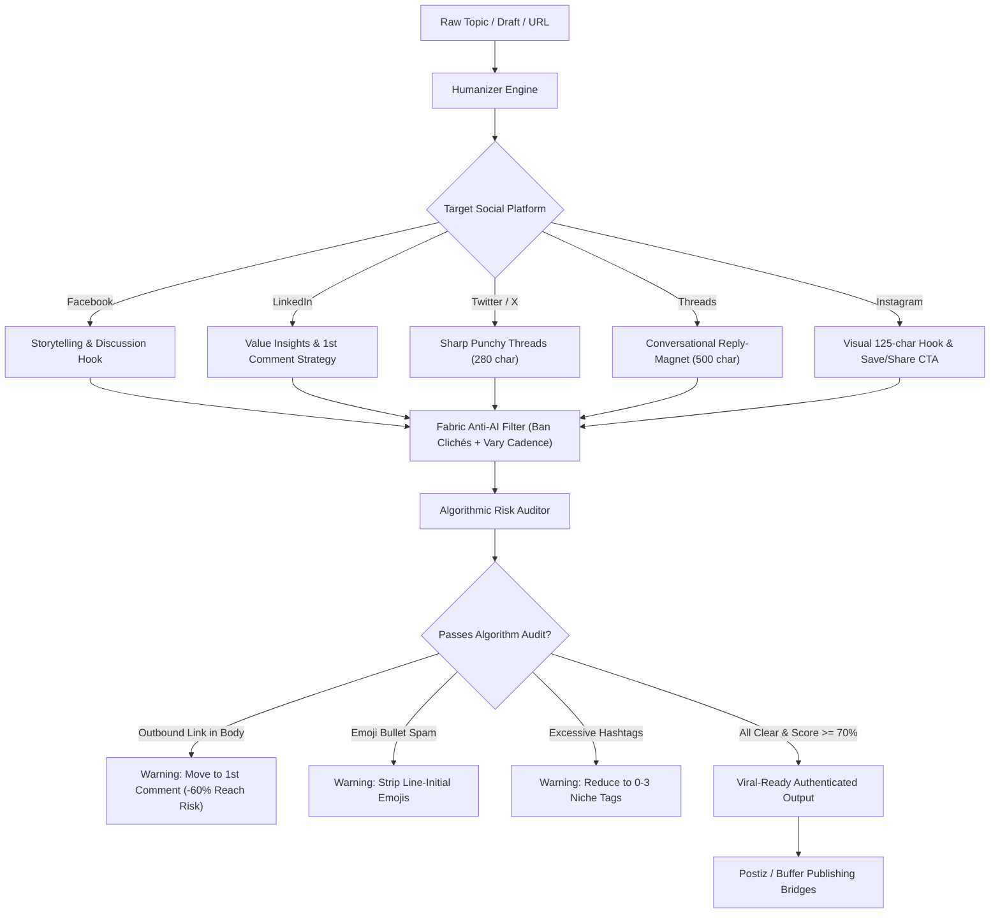

# Social-Humanizer 🧠✍️

[](https://opensource.org/licenses/MIT)
[](https://python.org)
[](#-platform-matrix)
[](#-algorithmic-risk-auditor)
[](https://github.com/Jubayer-ahamed42/social-humanizer/releases)
[](http://makeapullrequest.com)

> **Stop sounding like an AI bot. Stop getting crushed by social media feed algorithms.**  
> `social-humanizer` is a production-grade, open-source Python toolkit, CLI, and Web Playground that strips robotic AI patterns, enforces dynamic sentence burstiness, and audits posts for anti-reach algorithmic traps across **Facebook**, **LinkedIn**, **Twitter/X**, **Threads**, and **Instagram**.

---

## 🌪️ The Problem

Every social media platform algorithm in 2025–2026 aggressively demotes robotic AI spam:

1. **The 50%–80% Outbound Link Penalty**:
   - Posting raw URLs in the post body signals feed algorithms (LinkedIn, Facebook, Threads, X) that you are trying to take users off-platform. The algorithm suppresses organic reach by **50% to 80%**.
2. **Emoji Bullet & Stuffing Clutter**:
   - Starting lines with hype emojis (`🚀`, `🔥`, `💡`, `🎯`, `✨`) or scattering $> 2$ emojis across paragraphs triggers instant AI text classification, audience fatigue, and lower dwell time.
3. **Hashtag Stuffing (> 2 tags)**:
   - Modern 2026 feeds demote hashtag dumps as engagement-bait spam. Best practice across all platforms: **Maximum 1–2 targeted tags at the very end (or zero)**.
4. **The Machine Cadence Monotony**:
   - Standard LLMs write uniform 14–18 word sentences with near-zero sentence length variance ($\text{CV} < 0.25$). Real humans talk in bursts: punchy 2–4 word statements followed by long, conversational thoughts ($\text{CV} \ge 0.45$).
5. **Cringe AI Clichés (Bilingual EN + BN)**:
   - English: *"In today's fast-paced digital landscape...", "Let's delve into...", "a game-changer", "supercharge", "unleash"*.
   - Bengali: *"আজকের দ্রুত পরিবর্তনশীল বিশ্বে...", "আসুন এক নজরে দেখে নেওয়া যাক...", "সাফল্যের মূল চাবিকাঠি...", "নিচে আলোচনা করা হলো"*.

---

## 💡 The Solution: Social-Humanizer

`social-humanizer` provides a comprehensive anti-AI suite:

- **Anti-AI Philosophy (Fabric Engine)**: Aggressive cliché filtering, cadence de-monotonizing, modest first-person voice.
- **Platform-Specific Copywriting Engine**:
  - 📘 **Facebook**: Relatable community storytelling, 2–3 sentence natural blocks, low-friction curiosity hooks.
  - 💼 **LinkedIn**: Skimmable high-value insights, zero humblebragging, first-comment link strategy.
  - 🐦 **Twitter / X**: High-density hooks under 280 characters, structured multi-tweet threads.
  - 🧵 **Threads**: Casual, community-first banter, under 500 characters, reply-magnet questions (replies = #1 ranking factor), max 1 topic tag.
  - 📸 **Instagram**: Visual companion captions, 125-character hook before the `... more` fold, Saves & Shares CTAs, "Link in bio" compliance.
- **Algorithmic Risk Auditor**: Deterministic math auditor measuring:
  - Coefficient of Variation for sentence cadence: $\text{CV} = \frac{\sigma}{\mu}$
  - Outbound link detection and reach penalty alerts.
  - Emoji bullet spam detection.
  - Hashtag density & reach-farming warnings.
  - Enriched English and Bengali cliché detection.
- **Bilingual Native Support**: Fully supports English and Bengali (বাংলা) out of the box.
- **Visual Terminal Dashboard (CLI)**: High-contrast Rich terminal UI with colored scorecards and burstiness meters.
- **Interactive Web Playground**: Instant zero-dependency browser UI and Gradio compatibility.

---

## 🏛️ Architecture



---

## 📱 Platform Matrix
| Platform | Hard Limit | Formatting Vibe | Primary Ranking Metric | Optimal Links | Hashtags (End) | Emojis (Total) |
| :--- | :--- | :--- | :--- | :--- | :--- | :--- |
| **Facebook** | ~63,000 chars | Conversational 2-3 sentence blocks | Comments & Shares | First comment | 0–1 tag | 0–2 subtle |
| **LinkedIn** | 3,000 chars | Skimmable 1-2 sentence lines | Dwell Time & Comments | First comment | 1–2 tags max | 0–2 subtle |
| **Twitter / X** | 280 chars / post | High-density punchy threads | Retweets & Saves | Thread reply | 0–1 tag | 0–1 subtle |
| **Threads** | 500 chars | Informal, relatable peer chat | Reply Count | Profile bio / reply | 0–1 topic tag | 0–1 subtle |
| **Instagram** | 2,200 chars | 125-char hook + clean spacing | Saves & DM Shares | Link in bio | 1–2 tags max | 0–2 subtle |

---

## ⚡ Quickstart

### 1. Installation

**Install directly from GitHub via pip:**
```bash
pip install git+https://github.com/Jubayer-ahamed42/social-humanizer.git
```

**Or clone and install locally:**
```bash
git clone https://github.com/Jubayer-ahamed42/social-humanizer.git
cd social-humanizer
pip install -e .
```

*For standard non-editable local install:*
```bash
pip install .
```

*(Note: The core scoring engine and web server run in pure standard Python with zero mandatory dependencies!)*

---

### 2. Interactive Web Playground

Launch the interactive web demo in your browser:

```bash
python examples/app.py
```

Or using the demo launcher:

```bash
python demo/app.py
```

Then navigate to: **`http://127.0.0.1:7860`**

**Features:**
- Real-time Human Scorecard (0–100)
- Algorithmic Reach Penalty Risk Meter
- Dynamic Burstiness Meter ($\text{CV} = \sigma / \mu$)
- One-click Platform Switcher (FB, LinkedIn, X, Threads, IG)
- Preset Library (Robotic English, Cliché Bengali, Link Penalty, Authentic Post)
- Instant Copy to Clipboard

*Optional Gradio mode: if Gradio is installed, pass `--gradio`:*
```bash
python examples/app.py --gradio
```

---

### 3. Beautiful Terminal UI (CLI)

#### Audit and score any post for algorithmic risk:

```bash
python -m social_humanizer.cli score "🚀 Elevate your brand today! In today's fast-paced digital world, it is crucial to delve into revolutionary solutions. Check our link: https://example.com/start #ai #tech #saas #future #growth" -p linkedin
```

**Rich Output Preview:**

```text
┌─────────────────── 🚀 Social-Humanizer Quality Dashboard ───────────────────┐
│   AI DETECTED • HIGH ALGORITHM PENALTY                                      │
│                                                                             │
│ • Human Score: 20.0 / 100  • Algo Penalty Risk: 90 / 100 (High Risk)        │
└─────────────────────────────────────────────────────────────────────────────┘
               📊 Syntactic, Readability & Distribution Metrics                
┌────────────────┬──────────────────────┬──────────────┬──────────────────────┐
│ Metric         │ Value                │ Benchmark    │ Status Assessment    │
├────────────────┼──────────────────────┼──────────────┼──────────────────────┤
│ Human Quality  │ 20.0 / 100           │ ≥ 70.0 pts   │ Critical AI Markers  │
│ Burstiness     │ ████████░░ 0.42      │ CV ≥ 0.45    │ Moderate variety     │
│ Outbound Links │ 1 outbound link(s)   │ 0 in body    │ High reach penalty   │
│ Hashtag Density│ 5 tag(s)             │ 0 – 3 tags   │ Hashtag spam penalty │
└────────────────┴──────────────────────┴──────────────┴──────────────────────┘
                     🛡️ Algorithmic Risk Auditor Warnings                      
┌────────────┬────────┬───────────────────────────────────────────────────────┐
│ Category   │Severity│ Algorithmic Impact & Actionable Solution              │
├────────────┼────────┼───────────────────────────────────────────────────────┤
│ Outbound   │ HIGH   │ External link detected in post body. Platforms penal- │
│ Link       │        │ ize posts with outbound links by 50%-80%.             │
│            │        │ ↳ Fix: Move link to the first comment or bio.         │
├────────────┼────────┼───────────────────────────────────────────────────────┤
│ Emoji Spam │ MEDIUM │ Line-starting emoji bullets detected (🚀, 🔥, 💡).    │
│            │        │ ↳ Fix: Remove hype emojis; use conversational format. │
└────────────┴────────┴───────────────────────────────────────────────────────┘
```

#### Evaluate Bengali AI posts:

```bash
python -m social_humanizer.cli score "আজকের দ্রুত পরিবর্তনশীল বিশ্বে প্রোগ্রামিং শেখার গুরুত্ব অপরিসীম। আসুন এক নজরে দেখে নেওয়া যাক।"
```

#### Inspect Platform Prompts:

```bash
python -m social_humanizer.cli prompt -p threads
python -m social_humanizer.cli prompt -p instagram
python -m social_humanizer.cli prompt -p facebook
python -m social_humanizer.cli prompt -p linkedin
python -m social_humanizer.cli prompt -p twitter
```

---

### 4. Python SDK Usage

```python
from social_humanizer import evaluate_text, audit_algorithm, HumanizerEngine, Platform

# 1. Evaluate Text Quality & Algorithmic Compliance
post = (
    "I noticed something strange about software yesterday.\n\n"
    "Computers are fundamentally dumb.\n\n"
    "If you forget a single semicolon, the compiler completely gives up. "
    "Who else has spent half the night debugging only to find a typo?"
)

report = evaluate_text(post, platform="threads")

print(f"Human Score: {report.human_score}/100")
print(f"Algorithm Risk: {report.algorithm_risk_level}")
print(f"Burstiness CV: {report.burstiness_score}")
print(f"External Links: {len(report.external_links)}")
print(f"Hashtags: {report.hashtag_count}")

# 2. Inspect Algorithmic Warnings
if report.audit.warnings:
    for warning in report.audit.warnings:
        print(f"[{warning.severity.upper()}] {warning.category}: {warning.message}")
        print(f"  Fix: {warning.recommendation}")

# 3. Generate Humanizer Prompts for any LLM (Ollama, Gemini, Claude, OpenAI)
engine = HumanizerEngine()
payload = engine.build_prompt_payload(
    draft="Why moving from Windows to Linux WSL was surprisingly easy.",
    platform=Platform.THREADS
)
```

---

## 📊 Before vs. After Showcase

### ❌ Typical Robotic AI Post:
> 🚀 **Unleash Your Productivity Today!** 🔥  
> In today's fast-paced digital world, it is crucial to delve into revolutionary technologies. 💡  
> Here are 3 vital takeaways:  
> 🎯 Foster seamless team alignment  
> 🎯 Supercharge your daily output  
> 🎯 Navigate complex market challenges  
> Check out the full tool here: https://mycompany.com/tool 👇  
> `#AI #Productivity #Innovation #Tech #Future #Success`  
>  
> *⚠️ Algorithm Score: 15/100 | Reach Suppressed by ~75% due to outbound link & hashtag stuffing.*

### ✅ Humanized Authentic Post (`Platform.THREADS`):
> I spent three days testing every popular "productivity" app on the internet.  
>  
> Most of them just give you new places to type to-do lists you will still ignore.  
>  
> The only tool that actually helped? A plain physical notebook and turning off notifications for 3 hours.  
>  
> What is one productivity tool you secretly regret paying for?  
>  
> *(Link to my exact notebook setup in the replies below 💬)*  
>  
> *✅ Algorithm Score: 92/100 | High Reply Velocity & Zero Link Penalty.*

---

## 🔌 Schedulers & Bridges

Ready-to-use bridges for social media publishing:
- **`BufferBridge`**: Integrates with [Buffer](https://buffer.com) (official LinkedIn partner) via `social_humanizer.integrations.BufferBridge`.
- **`PostizBridge`**: Integrates with [Postiz](https://github.com/gitroomhq/postiz-app) (the leading open-source scheduler) via `social_humanizer.integrations.PostizBridge`.

---

## 🧪 Running Tests

Run the full test suite with 100% test coverage:

```bash
python -m unittest discover -s tests -p "test_*.py"
```

All 45 unit tests verify:
- Anti-AI prompt rules across Facebook, LinkedIn, Twitter/X, Threads, and Instagram.
- Outbound link reach suppression detection (50%–80% warning) including common URL shorteners (bit.ly, lnkd.in, youtu.be).
- Line-initial and markdown emoji bullet pattern detection.
- Global emoji count tracking (strict max 1–2 subtle emojis).
- Strict hashtag limits (max 1–2 tags placed at the very end).
- Mid-text hashtag detection and warnings.
- Shannon Vocabulary Entropy ($H$) and Lexical Diversity (Type-Token Ratio, TTR).
- First 120-character above-the-fold Hook Quality analysis and stop-scroll scoring.
- Sentence splitting precision across numbered lists and abbreviations.
- Burstiness variance calculations ($\text{CV} = \sigma / \mu$).
- Bilingual cliché blacklists (English + Bengali).
- Rich CLI terminal rendering, CI/CD `--lint` exit-code enforcement, native OS clipboard copy (`-c` / `--copy`), and piped stdin support.
- Web Playground REST API endpoints (`/api/evaluate`, `/api/prompt`, `/api/generate`) and offline anti-AI rewrite engine.

---

## 🤝 Contributing

Contributions are welcome! Please check out our [LICENSE](LICENSE) (MIT) and feel free to submit issues or pull requests.

---

## 📜 License

Distributed under the **MIT License**. See [`LICENSE`](LICENSE) for more information.
